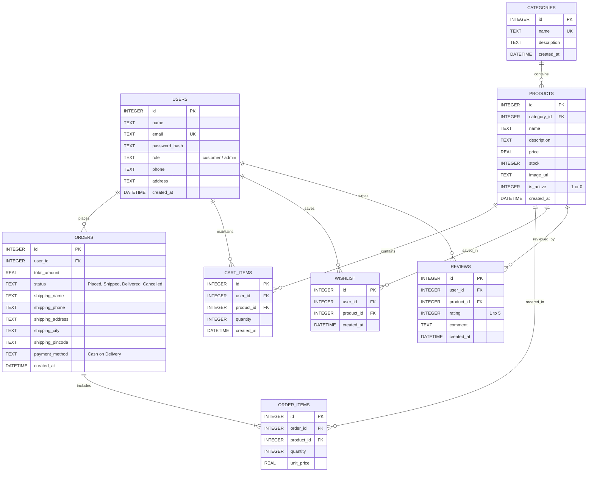

# ShopEasy – Entity-Relationship (ER) Diagram

This document describes the relational database schema implemented in SQLite for **ShopEasy E-Commerce**.

---

## 1. Mermaid Entity-Relationship Diagram

---

## 2. Table Specifications & Cardinalities

### 1. `users`
- **Primary Key:** `id`
- **Role:** `'customer'` (default) or `'admin'`
- **Security:** `password_hash` stores 10-round salted `bcrypt` hashes; plaintext passwords are never stored.

### 2. `categories`
- **Primary Key:** `id`
- **Unique Constraint:** `name`
- **Relationship:** One category has many products (`1:N`).

### 3. `products`
- **Primary Key:** `id`
- **Foreign Key:** `category_id` references `categories(id)` with `ON DELETE CASCADE`.
- **Integrity Checks:** `CHECK(price >= 0)` and `CHECK(stock >= 0)`.
- **Low-Stock Criteria:** `stock < 5` (ADM-6).
- **Out-of-Stock Criteria:** `stock = 0` (PRD-7 prevents adding to cart).

### 4. `cart_items`
- **Primary Key:** `id`
- **Foreign Keys:** `user_id` references `users(id)`, `product_id` references `products(id)`.
- **Unique Constraint:** `UNIQUE(user_id, product_id)` ensures no duplicate rows per product per user.

### 5. `orders`
- **Primary Key:** `id`
- **Foreign Key:** `user_id` references `users(id)`.
- **Status Enum:** `'Placed'`, `'Shipped'`, `'Delivered'`, `'Cancelled'`.
- **Payment Method:** `'Cash on Delivery'`.

### 6. `order_items`
- **Primary Key:** `id`
- **Foreign Keys:** `order_id` references `orders(id)`, `product_id` references `products(id)`.
- **Snapshot Pricing:** `unit_price` preserves price at time of order regardless of future catalog changes.
- **Relationship:** One order contains one or more order items (`1:N`).

---

## 3. Database Transactions & Integrity

- **Foreign Key Enforcement:** Enabled on every SQLite connection via `PRAGMA foreign_keys = ON;`.
- **Checkout Transaction (`POST /api/orders`):**
  1. Validates that cart is not empty.
  2. Confirms active status and verifies sufficient stock for every product.
  3. Inserts into `orders`.
  4. Inserts into `order_items`.
  5. Atomically deducts product stock in `products`.
  6. Empties the user's `cart_items`.
  7. If any step fails, the entire transaction is rolled back.
- **Cancellation Transaction (`POST /api/orders/:id/cancel`):**
  1. Verifies order is in `'Placed'` status.
  2. Updates order status to `'Cancelled'`.
  3. Restores inventory stock for all products in the order.
